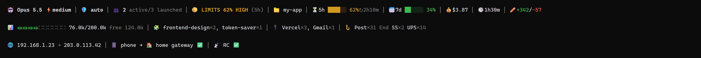

# 18. Status Line

A 3-line status bar that keeps every number this protocol cares about in view: model, effort, limits, context, tools in use, network and remote control. It is a script, not a model call, so it costs zero tokens.



*Demo with invented data (documentation IP ranges, fake session).*

## Install

1. Copy [`scripts/statusline.py`](scripts/statusline.py) somewhere stable.
2. Add it to the global `settings.json`:

```json
{
  "statusLine": {
    "type": "command",
    "command": "python /path/to/statusline.py"
  }
}
```

3. Start a new session. The CLI pipes a JSON payload to the script on stdin and prints whatever the script writes to stdout.

Requires Python 3 only (stdlib). Missing fields are skipped, so the bar degrades gracefully on plans or versions that do not send them.

## Line 1: session and limits

| Segment | Meaning |
|---|---|
| `🤖 Opus 5.5 ⚡medium` | Model and effort |
| `🛡️ auto` | Permission mode |
| `👥 2 active/3 launched` | Subagents: still running vs total started |
| `🟡 LIMITS 62% HIGH (5h)` | Limit score: the highest of context, 5-hour and 7-day usage, with the bottleneck in brackets |
| `📁 my-app` | Working folder |
| `⏳5h` / `📅7d` | Session and weekly quota bars, with time to reset |
| `💰 🕒 ✏️` | Cost, duration, lines added/removed |

Score bands: 🟢 under 50% (OK), 🟡 50-80% (HIGH), 🔴 over 80% (CRITICAL). A red score is the cue to write `HANDOFF.md` and `/clear` ([step 3](03-session-lifecycle.md)).

## Line 2: context and tools in use

| Segment | Meaning |
|---|---|
| `📊 ⛁⛁⛁⛁⛶⛶⛶⛶⛶⛶ 76.0k/200.0k free 124.0k` | Compact `/context` view: used, total, free |
| `🧩 frontend-design×2` | Skills the assistant called this session |
| `🔌 Vercel×3` | MCP servers called this session |
| `🪝 Post×31 End SS×2 UPS×14` | Hooks: fired count, dimmed when configured but not fired yet |

Hook short names: `SS` SessionStart, `UPS` UserPromptSubmit, `Pre` PreToolUse, `Post` PostToolUse, `End` SessionEnd.

The status line cannot show the per-category table of the real `/context` (system prompt, tools, skills, memory, messages). The CLI sends only totals. Run `/context` for the breakdown.

## Line 3: network and remote control

`🌐 192.168.1.23 → 203.0.113.42 │ 📱 phone → 🏠 home gateway ✅ │ 📡 RC ✅`

- Local IP and public IP (read with `curl.exe`, see [step 13](13-network-and-naming.md)).
- Path: `🖥️ direct (adapter name)` on a normal link, `📱 phone` when the default route goes through a USB-tethered phone. With `adb` available, the script also asks the phone whether its VPN interface is up and shows `→ 🏠 home gateway ✅` ([step 16](16-android-proxy-setup.md)). Remove this part if you do not use a phone as a proxy.
- `📡 RC`: remote control connected (✅), off, or `?` when the session file is not found.

## How the data is collected

| Data | Source |
|---|---|
| Model, cost, limits, context | JSON payload from the CLI (stdin) |
| Skills, MCP, hooks fired, agents | Session transcript, read incrementally and cached in the temp folder (about 0.1 s per refresh even on multi-MB transcripts) |
| Hooks configured | Global, project and enabled-plugin `settings`/`hooks.json` |
| Effort, permission mode (fallback) | `settings.json`, marked with `*` when the live value is not in the payload |
| IPs, tethering, phone VPN | A detached background process, refreshed every 45 s, result cached. The bar never waits on the network. |
| Remote control | The CLI's own session file (`bridgeSessionId` present = connected) |

## Known limits

- `*` after effort or mode means the value comes from `settings.json`. A change made with `/effort` or shift+tab inside the session may not show until the CLI sends it in the payload.
- "Active" agents is an estimate: an agent counts as running until its result arrives, and background agents can return at once.
- Skills the user starts with a slash command are not counted, only tool calls.
- Emoji need a terminal font that renders them.
